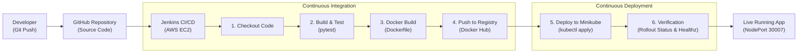

# Drug Tariff Analytics — CI/CD Pipeline & Kubernetes Deployment

> **CCA 2: CI/CD Pipeline Implementation and Deployment of an Existing Project**  
> **Course:** TYCSE · Cloud Computing and DevOps  
> **Application:** Drug Tariff Analytics (Flask Web Dashboard)

---

## 1. Project Overview

**Drug Tariff Analytics** is a modular Python Flask web application designed for analyzing pharmaceutical price movements, NHS Drug Tariff category shifts, and price concessions. It features:
- Interactive data visualizations with Chart.js
- Real-time price trend calculations and Category A/C/M comparisons
- Dedicated health check endpoint at `/healthz` for container and orchestrator probes
- Robust automated test suite using `pytest` covering pipeline calculations, routes, and authentication

This repository has been fully automated with an end-to-end **Continuous Integration & Continuous Deployment (CI/CD)** pipeline using **Jenkins**, **Docker**, **Docker Hub**, and **Kubernetes (Minikube)** hosted on **AWS EC2**.

---

## 2. CI/CD Architecture



---

## 3. Pipeline Stages Breakdown

| Step | Stage | What Happens |
| :--- | :--- | :--- |
| **1** | **Source Code** | Source code maintained in GitHub repository with version control. |
| **2** | **Jenkins Checkout** | Jenkins pulls the latest commit from the GitHub repository (`checkout scm`). |
| **3** | **Build and Test** | Creates a virtual environment, installs dependencies from `requirements-dev.txt`, and executes automated tests with `pytest -v`. |
| **4** | **Docker Build** | Builds an optimized container image from `Dockerfile`, tagged with both `${BUILD_NUMBER}` and `latest`. |
| **5** | **Push Image** | Authenticates securely with Docker Hub using Jenkins credentials and pushes both tagged images. |
| **6** | **Minikube Deployment** | Applies Kubernetes manifests (`k8s/deployment.yaml` and `k8s/service.yaml`), replacing the image tag dynamically. |
| **7** | **Verification** | Checks `kubectl rollout status`, verifies pod health, inspects service endpoints, and validates the `/healthz` endpoint. |

---

## 4. Repository Structure

```
├── .dockerignore              # Excludes unnecessary files from container build context
├── .github/workflows/         # GitHub Actions workflow for repository checks
├── Dockerfile                 # Multi-stage production container definition
├── Jenkinsfile                # Declarative 7-stage CI/CD pipeline
├── README.md                  # Project documentation & deployment report
├── app.py                     # Flask web application and REST API endpoints
├── pipeline.py                # Data processing and analytics logic
├── sample.py                  # Seed sample dataset
├── requirements.txt           # Production dependencies
├── requirements-dev.txt       # Testing & CI dependencies (pytest)
├── test_app.py                # Unit and integration tests for Flask app
├── test_pipeline.py           # Unit tests for data pipeline
├── web/                       # Frontend HTML, CSS, and JS assets
│   ├── index.html             # Dashboard UI
│   └── admin.html             # Admin interface
└── k8s/                       # Kubernetes manifests
    ├── deployment.yaml        # Deployment specification (2 replicas, rolling updates)
    └── service.yaml           # NodePort Service specification (Port 30007)
```

---

## 5. Prerequisites & AWS Infrastructure Setup

### 5.1 AWS EC2 Instance Provisioning
1. **Instance Type**: `t3.medium` or `t3.large` (minimum 2 vCPUs, 4 GB RAM recommended for running Jenkins + Minikube + Docker simultaneously).
2. **OS**: Ubuntu 22.04 LTS or 24.04 LTS.
3. **Storage**: Minimum 25–30 GB gp3 root EBS volume.
4. **Security Group Inbound Rules**:
   - `SSH` (Port 22) from your IP
   - `Custom TCP` (Port 8080) for Jenkins Web Dashboard
   - `Custom TCP` (Port 30007) for Minikube NodePort application access

### 5.2 Server Software Installation (AWS EC2)

Connect to your EC2 instance via SSH:
```bash
ssh -i your-key.pem ubuntu@<EC2_PUBLIC_IP>
```

#### Step 1: Install Docker
```bash
sudo apt update && sudo apt install -y curl apt-transport-https ca-certificates software-properties-common
curl -fsSL https://download.docker.com/linux/ubuntu/gpg | sudo gpg --dearmor -o /etc/apt/trusted.gpg.d/docker.gpg
sudo add-apt-repository "deb [arch=amd64] https://download.docker.com/linux/ubuntu $(lsb_release -cs) stable"
sudo apt update && sudo apt install -y docker-ce docker-ce-cli containerd.io
sudo usermod -aG docker $USER
```

#### Step 2: Install Java & Jenkins
```bash
sudo apt install -y fontconfig openjdk-17-jre
sudo wget -O /usr/share/keyrings/jenkins-keyring.asc https://pkg.jenkins.io/debian-stable/jenkins.io-2023.key
echo "deb [signed-by=/usr/share/keyrings/jenkins-keyring.asc] https://pkg.jenkins.io/debian-stable binary/" | sudo tee /etc/apt/sources.list.d/jenkins.list > /dev/null
sudo apt update && sudo apt install -y jenkins
sudo systemctl enable jenkins
sudo systemctl start jenkins

# Grant Jenkins permission to run Docker and Kubernetes commands
sudo usermod -aG docker jenkins
sudo systemctl restart jenkins
```

#### Step 3: Install Minikube & kubectl
```bash
# Install kubectl
curl -LO "https://dl.k8s.io/release/$(curl -L -s https://dl.k8s.io/release/stable.txt)/bin/linux/amd64/kubectl"
sudo install -o root -g root -m 0755 kubectl /usr/local/bin/kubectl

# Install Minikube
curl -LO https://storage.googleapis.com/minikube/releases/latest/minikube-linux-amd64
sudo install minikube-linux-amd64 /usr/local/bin/minikube && rm minikube-linux-amd64

# Start Minikube using docker driver
minikube start --driver=docker

# Enable Jenkins user to access kubeconfig
sudo mkdir -p /var/lib/jenkins/.kube
sudo cp -r /home/ubuntu/.kube/config /var/lib/jenkins/.kube/config
sudo cp -r /home/ubuntu/.minikube /var/lib/jenkins/.minikube
sudo chown -R jenkins:jenkins /var/lib/jenkins/.kube /var/lib/jenkins/.minikube
```

---

## 6. Jenkins Configuration

1. **Access Jenkins**: Open `http://<EC2_PUBLIC_IP>:8080`.
2. **Unlock Jenkins**: Get the initial admin password:
   ```bash
   sudo cat /var/lib/jenkins/secrets/initialAdminPassword
   ```
3. **Install Suggested Plugins**: Plus install the **Docker Pipeline** and **AnsiColor** plugins via *Manage Jenkins > Plugins*.
4. **Configure Docker Hub Credentials**:
   - Go to *Manage Jenkins > Credentials > System > Global credentials > Add Credentials*.
   - **Kind**: Username with password.
   - **Username**: Your Docker Hub username.
   - **Password**: Your Docker Hub password or Personal Access Token.
   - **ID**: `dockerhub-credentials` *(matches `Jenkinsfile`)*.
5. **Create Pipeline Job**:
   - New Item -> Name: `rug-tariff-ci-cd` -> Select **Pipeline** -> OK.
   - Under **Pipeline Definition**, select **Pipeline script from SCM**.
   - **SCM**: Git.
   - **Repository URL**: `https://github.com/<YOUR_GITHUB_USERNAME>/rug-tariff-analytics.git`.
   - **Branch Specifier**: `*/main` or `*/master`.
   - **Script Path**: `Jenkinsfile`.
   - Click **Save**.

---

## 7. Containerization & Dockerfile Details

The [`Dockerfile`](Dockerfile) is written according to container best practices:
- **Base Image**: `python:3.12-slim` for minimal vulnerability surface and fast build times (~150MB).
- **Layer Caching**: `requirements.txt` is copied and installed prior to copying application source code.
- **Security**: Creates an unprivileged system user `appuser` (UID 1000) so the process does not run as root inside the container.
- **Production Server**: Runs with **Gunicorn** WSGI server with 2 workers and 4 threads.
- **Built-in Healthcheck**: Automatically polls `/healthz` to detect deadlocks.

```dockerfile
FROM python:3.12-slim
WORKDIR /app
COPY requirements.txt .
RUN pip install --no-cache-dir -r requirements.txt
COPY . .
RUN useradd -m -u 1000 appuser && chown -R appuser:appuser /app
USER appuser
EXPOSE 5000
CMD ["gunicorn", "app:app", "--bind", "0.0.0.0:5000", "--workers", "2", "--threads", "4"]
```

---

## 8. Kubernetes Manifests Details

### 8.1 Deployment ([`k8s/deployment.yaml`](k8s/deployment.yaml))
- **Replicas**: 2 (ensures zero downtime during updates).
- **RollingUpdate Strategy**: `maxSurge: 1`, `maxUnavailable: 0` ensures existing pods remain healthy until new pods pass health checks.
- **Liveness & Readiness Probes**: Continuously monitors `http://localhost:5000/healthz`.
- **Resource Constraints**: Requests 100m CPU / 128Mi RAM, limits 500m CPU / 512Mi RAM.

### 8.2 Service ([`k8s/service.yaml`](k8s/service.yaml))
- **Type**: `NodePort`
- **Port**: 80 (Internal cluster routing)
- **TargetPort**: 5000 (Flask application container port)
- **NodePort**: `30007` (Directly accessible externally via Minikube / EC2)

---

## 9. Verification & Live Demo

Once Jenkins triggers the build, monitor the pipeline execution:
1. Verify pod rollout:
   ```bash
   kubectl get pods -l app=rug-tariff-analytics -o wide
   ```
2. Verify service mapping:
   ```bash
   kubectl get svc rug-tariff-service
   ```
3. Test application health endpoint:
   ```bash
   curl http://localhost:30007/healthz
   # Expected response: {"status":"ok","time":"..."}
   ```
4. Access web dashboard in browser:
   - On AWS EC2: `http://<EC2_PUBLIC_IP>:30007` *(ensure port 30007 is allowed in EC2 Security Group)*.
   - Alternatively via Minikube tunnel / service command:
     ```bash
     minikube service rug-tariff-service --url
     ```

---

## 10. Demonstration of Source-Code Change (Redeployment Viva)

Requirement #9 of the evaluation guidelines specifies demonstrating an automated redeployment upon code change:

1. Edit the title or add a release banner in [`web/index.html`](web/index.html):
   ```html
   <!-- Change banner or heading in web/index.html -->
   <span class="badge">v2.0 - CI/CD Deployed</span>
   ```
2. Commit and push the changes:
   ```bash
   git add web/index.html
   git commit -m "feat: release v2.0 with live CI/CD update"
   git push origin main
   ```
3. In Jenkins, click **Build Now** (or wait for GitHub Webhook trigger).
4. Observe the pipeline:
   - Test stage runs and passes.
   - New Docker image tagged with `#2` is created and pushed.
   - Minikube triggers a **Rolling Update**.
   - Refresh `http://<EC2_PUBLIC_IP>:30007` to verify the new version is live with **zero downtime**.
